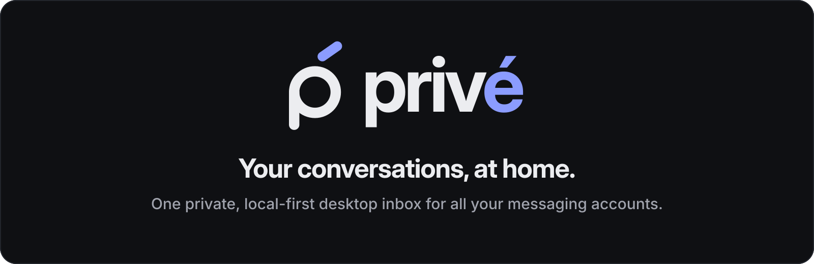

<picture>
  <source media="(prefers-color-scheme: light)" srcset="assets/brand/social/prive-banner-light.svg">
  
</picture>

# Privé

**One fast, private, local-first desktop app for all your messaging accounts.**

Privé (`prive`) brings WhatsApp — and, over time, Telegram, Slack, Signal, Instagram and more — into a single
minimal window. Think Beeper, but:

- **Local-first**: your sessions, chats and messages live only on your computer, in a local SQLite database.
- **No account**: there is no Privé account and no Privé server. Ever.
- **No telemetry**: the app talks only to the messaging networks you connect.
- **Fast**: a native Go backend with a lightweight web UI (Wails), built for quick startup and low memory.
- **Unlimited accounts**: connect as many accounts as you want, including several of the same network.
- **Multilingual**: English and Spanish from day one; community translations welcome.
- **Open and extensible**: every network is an *engine* with a small, documented interface.

> **Status:** early development. The app skeleton runs, but no network is connected yet — see the [roadmap](#roadmap).
> Platforms: macOS first, then Windows and Linux.

## How it works

```
 ┌──────────────── Privé (one process) ────────────────┐
 │  React UI  ◀── Wails events / bindings ──▶  Go core │
 │                                              │      │
 │                     ┌────────────────────────┤      │
 │                     ▼            ▼           ▼      │
 │               WhatsApp engine  Telegram   ...       │
 │               (whatsmeow)      engine               │
 │                     │                               │
 │                SQLite (local)                       │
 └─────────────────────┼───────────────────────────────┘
                       ▼
            The messaging networks themselves
```

Read more in [`docs/ARCHITECTURE.md`](docs/ARCHITECTURE.md).

## Tech stack

| Layer | Choice |
|---|---|
| Desktop shell | [Wails v2](https://wails.io) |
| Backend | Go |
| Frontend | React + TypeScript + Tailwind CSS, Zustand, react-i18next |
| Storage | SQLite via `ncruces/go-sqlite3` (pure Go, no CGO), encrypted at rest, with FTS5 ([ADR 0006](docs/adr/0006-sqlite-driver-ncruces.md), [ADR 0007](docs/adr/0007-encryption-at-rest.md)) |
| WhatsApp | [whatsmeow](https://github.com/tulir/whatsmeow) |

## Installation (development)

> Prebuilt releases will follow after the MVP.

### Prerequisites (macOS)

```bash
# Xcode command line tools
xcode-select --install

# Go (1.26+) and Node.js (20+)
brew install go node

# Wails CLI
go install github.com/wailsapp/wails/v2/cmd/wails@latest
# Make sure $(go env GOPATH)/bin is on your PATH, then:
wails doctor
```

Windows and Linux prerequisites: see the [Wails installation guide](https://wails.io/docs/gettingstarted/installation).
On Linux distributions that ship only WebKitGTK 4.1 (e.g. Ubuntu 24.04), add `-tags webkit2_41` to
`wails dev`, `wails build`, `go vet` and `go test`.

### Run in development mode

```bash
git clone https://github.com/baddiamond/prive.git
cd prive
wails dev
```

### Build

```bash
wails build                          # current platform → build/bin/
wails build -platform darwin/universal   # macOS Intel + Apple Silicon
```

### Tests

```bash
go test ./...
cd frontend && npm install && npm run lint && npm run typecheck
```

The frontend type check needs the Wails bindings in `frontend/wailsjs/`. They are generated by
`wails dev` / `wails build`, or on their own with `wails generate module`.

## Where is my data?

| OS | Location |
|---|---|
| macOS | `~/Library/Application Support/Prive` |
| Windows | `%AppData%\Prive` |
| Linux | `~/.local/share/prive` |

Deleting that folder removes every session, chat and setting. Nothing is stored anywhere else.

## Adding a language

1. Copy `frontend/src/locales/en.json` to `frontend/src/locales/<code>.json` (e.g. `fr.json`).
2. Translate the values (never the keys).
3. Register the language in `frontend/src/i18n.ts` and add its native name under `settings.language.options`.
4. Open a pull request.

Full guide: [`docs/I18N.md`](docs/I18N.md).

### Developer tool

`cmd/prive-dev` drives the backend from the terminal, with the same encrypted data as the app.
Quit Privé first: two processes must not run the same sessions.

```bash
go run ./cmd/prive-dev link Personal green   # shows a QR code to scan with WhatsApp
go run ./cmd/prive-dev accounts              # lists accounts and their connection state
go run ./cmd/prive-dev remove <id-prefix>    # logs out and deletes an account
```

To work on the account screens without a phone, build with the `devfake` tag: the in-memory test engine
appears as a network called "Fake" and links instantly (`wails dev -tags devfake`). Release builds never include it.

## Adding a network (engine)

Each network lives in `internal/engines/<id>/` and implements two interfaces (`Engine` and `Session`).
Copy the template, implement it, pass the shared conformance tests, add translations and an icon.
Step by step: [`docs/ADDING_AN_ENGINE.md`](docs/ADDING_AN_ENGINE.md).

## Roadmap

Detailed version: [`docs/ROADMAP.md`](docs/ROADMAP.md).

**Phase 1 — MVP (WhatsApp)**

- [x] **0. Bootstrap** — repo docs, Wails + React + TS + Tailwind skeleton, i18n (en/es), dark mode, CI
- [x] **1. Core & store** — engine interfaces, registry, multi-account manager, SQLite, conformance suite
- [x] **2. WhatsApp login** — QR pairing, persisted sessions, auto-reconnect, unlimited accounts
- [x] **3. Chat list** — history import, unified inbox + per-account filter, unread counters, recovery phrase
- [x] **4. History** — conversation view, paginated history cached locally, older messages from the phone
- [x] **5. Real time** — send and receive text messages live, delivery and read status, mark as read
- [ ] **6. Polish** — keyboard shortcuts, startup/memory profiling, macOS/Windows/Linux builds

**Future features** ([details](docs/ROADMAP.md#future-features))

- Optional app password for the encrypted database (encryption and the recovery phrase are already on)
- Lock and hide chats or whole accounts, exclude them from search
- Search across all accounts: full-text, plus opt-in semantic search — all on this computer
- Opt-in voice note transcription on this computer
- Media (images, audio, documents), reactions, replies, edits
- Notifications and tray/menu bar icon
- More engines: Telegram, Signal, Slack, Instagram, Discord, Matrix… (community welcome)
- Out-of-process engines (write an engine in any language over stdio)

## Design

- [UI specification](docs/UI.md) — app shell, components, states, keyboard, accessibility
- [First run](docs/ONBOARDING.md) — onboarding flow
- [System requirements](docs/REQUIREMENTS.md) — device tiers and feature defaults
- [Design sources](design/) — interactive prototype sources

## Brand

Logo, icons, colors, typography, voice and accessibility rules live in the
[brand guide](docs/brand/BRAND.md). All assets are in [`assets/brand/`](assets/brand/) and are generated from code.

## Contributing

Contributions from humans and AI-assisted contributors are welcome.
Start with [`CONTRIBUTING.md`](CONTRIBUTING.md) and the project rules in [`CLAUDE.md`](CLAUDE.md).

## Responsible use, privacy and security

Privé is an independent project, not affiliated with WhatsApp, Meta or any other network.
It uses unofficial connections, which a network may restrict — use it at your own risk.
It is a **personal** client: spam, bulk messaging, scraping and surveillance are not allowed.

- [Disclaimer](DISCLAIMER.md) · [Acceptable Use Policy](ACCEPTABLE_USE.md) · [Privacy](PRIVACY.md)
- [Security policy](SECURITY.md) · [Code of conduct](CODE_OF_CONDUCT.md)

## License

The source code is [MIT](LICENSE) © Privé contributors.

Release builds include the WhatsApp engine, which depends on a GPL-3.0 library (`go.mau.fi/libsignal`), so those
**binaries are distributed under the GPL-3.0** ([ADR 0012](docs/adr/0012-gpl-binaries-with-whatsapp.md)).
