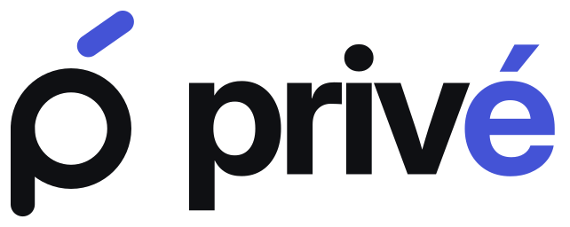
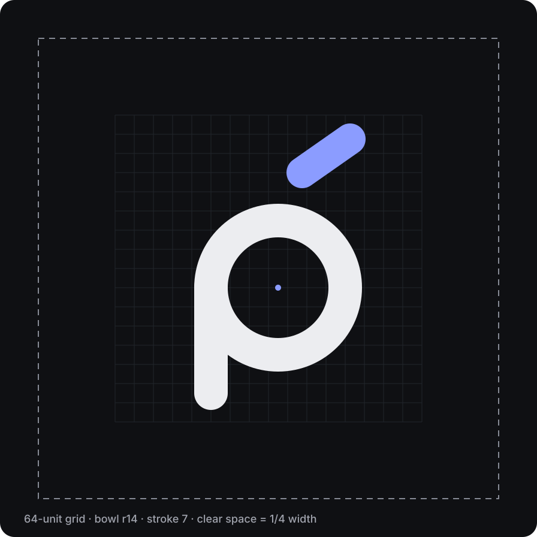
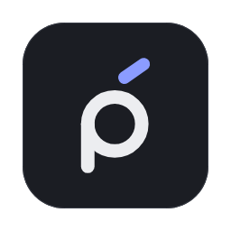
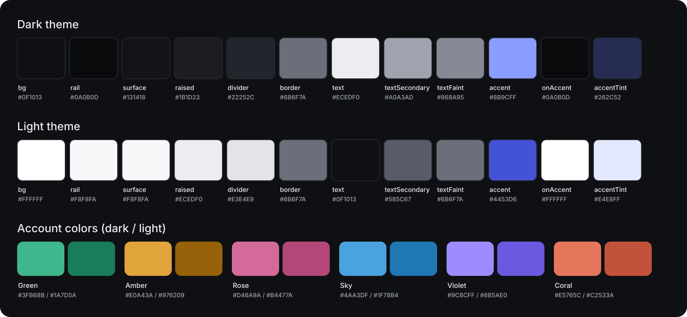

# Privé brand guide

<picture>
  <source media="(prefers-color-scheme: light)" srcset="../../assets/brand/social/prive-banner-light.svg">
  
</picture>

This guide describes who Privé is and how it looks, sounds and behaves. It is for contributors, designers,
translators, packagers and anyone writing about the project. Version 0.1.

All files live in [`assets/brand/`](../../assets/brand/). They are generated from code by
[`scripts/brand/generate.py`](../../scripts/brand/generate.py), so they can be rebuilt and improved by anyone.

**Contents:**
[Essence](#1-essence) ·
[Logo](#2-logo) ·
[App and tray icons](#3-app-and-tray-icons) ·
[Color](#4-color) ·
[Typography](#5-typography) ·
[Icons, shape and motion](#6-icons-shape-and-motion) ·
[Voice and tone](#7-voice-and-tone) ·
[Accessibility](#8-accessibility) ·
[Files and tokens](#9-files-and-tokens) ·
[Using the brand](#10-using-the-brand)

---

## 1. Essence

> **Your conversations, at home.**

Privé brings every conversation into one calm, fast place that lives only on your computer.
No account, no servers in the middle, nothing to sell.

The name is French for *private*. Write it **Privé** in text (with the accent) and `prive` in code,
file names, package names and URLs.

### Five promises

| # | Promise | What it means |
|---|---|---|
| 01 | **Local by design** | Everything stays on your computer. Delete one folder and it is all gone. |
| 02 | **Yours, no sign-up** | No Privé account, no tracking, no telemetry. Ever. |
| 03 | **One calm place** | Every account and network speaks the same simple language. |
| 04 | **Fast and light** | Opens instantly, stays out of the way, respects your battery. |
| 05 | **Open to everyone** | Open source, accessible, multilingual, built with its community. |

### The feeling we aim for

| Feels like | Never like |
|---|---|
| A quiet room with good light | A social feed fighting for attention |
| A sealed envelope | An ad-supported app |
| A well-kept notebook | A corporate dashboard |
| A key that only you hold | A noisy notification center |

**Personality:** discreet · calm · quick · honest · welcoming.

---

## 2. Logo

The mark is a lowercase **p** whose bowl is a chat bubble and whose stem is its tail, crowned by the
acute accent of priv**é**. The accent is our signature: it appears in the mark, colors the **é** of the
wordmark, and inspires the focus ring and the accent color across the app.

| Lockup on dark | Lockup on light |
|---|---|
|  |  |

| Variant | Files |
|---|---|
| Mark | `logo/prive-mark-{on-dark,on-light,mono-white,mono-black}.svg` |
| Wordmark | `logo/prive-wordmark-{on-dark,on-light,mono-white,mono-black}.svg` |
| Lockup (mark + wordmark) | `logo/prive-lockup-{on-dark,on-light,mono-white,mono-black}.svg` |
| PNG exports | `logo/png/` (mark 512 px, lockup 1200 px wide) |

- **on-dark / on-light**: two-color versions. The accent is Lavender 400 on dark and Indigo 600 on light.
- **mono-white / mono-black**: one color, for print, embroidery, stamps or busy backgrounds.

### Construction



- Drawn on a **64-unit grid**: bowl radius 14, stroke 7, accent stroke 6.5 at about 35°, round caps.
- **Clear space**: a quarter of the mark's width on every side. Keep text and other graphics outside it.
- **Minimum size**: mark 16 px, lockup 72 px wide.
- In the lockup, the mark's bowl is 1.32× the wordmark's x-height and centered on it.
- The wordmark is **Inter Display Bold** with −0.045 em tracking, converted to outlines.

### Please don't

- Recolor any part except the accent (or use a mono version).
- Stretch, squash, rotate or skew the logo, or flip the accent.
- Add shadows, glows, outlines, gradients or textures.
- Place it with less than 3 : 1 contrast against its background.
- Rebuild the wordmark with a live font, or set "Privé" in another typeface as a logo.
- Combine it with another brand's logo in a way that suggests a partnership.

---

## 3. App and tray icons




| Use | Files |
|---|---|
| App icon (source) | `icon/prive-app-icon.svg`, `icon/prive-app-icon-light.svg` |
| PNG sizes | `icon/png/prive-app-icon-{16,32,64,128,256,512,1024}.png` |
| macOS | `icon/prive.icns` |
| Windows | `icon/prive.ico` (16–256 px) |
| Wails build | `build/appicon.png`, `build/windows/icon.ico` (copied by the generator) |
| macOS menu bar | `tray/prive-tray-template.svg` + `tray/png/prive-tray-template{,@2x}.png` (black + alpha, used as a template image) |
| Windows / Linux tray | `tray/prive-tray-white.svg` + `tray/png/prive-tray-white{,@2x,-22,-22@2x}.png` |

- The app icon follows the macOS icon grid: an 824 px rounded tile on a 1024 px canvas, mark at 62% of the tile.
- Tray icons are one color with slightly heavier strokes (8 units) so they stay crisp at 16 px.

---

## 4. Color

**Ink & Lavender.** Quiet neutrals carry the interface; one accent marks what matters.
Roughly **90% neutrals, 8% account colors, 2% accent**. No gradients, no glows.



### Themes

Dark is the default. Light follows the OS or the user's choice in Settings.

| Role | Dark | Light | Use |
|---|---|---|---|
| `bg` | `#0F1013` | `#FFFFFF` | Window background |
| `rail` | `#0A0B0D` | `#F8F8FA` | Account rail |
| `surface` | `#131418` | `#F8F8FA` | Panels, chat list |
| `raised` | `#1B1D23` | `#ECEDF0` | Fields, incoming bubbles, cards |
| `divider` | `#22252C` | `#E3E4E9` | Decorative lines only |
| `border` | `#6B6F7A` | `#6B6F7A` | Control borders (inputs, outlined buttons) — ≥ 3 : 1 |
| `text` | `#ECEDF0` | `#0F1013` | Primary text |
| `textSecondary` | `#A0A3AD` | `#585C67` | Secondary text, timestamps |
| `textFaint` | `#868A95` | `#6B6F7A` | Hints, metadata |
| `accent` | `#8B9CFF` | `#4453D6` | Primary actions, focus, unread badges |
| `onAccent` | `#0A0B0D` | `#FFFFFF` | Text on accent |
| `accentTint` | `#262C52` | `#E4E8FF` | Outgoing bubbles, selected states |

### Account colors

Each account gets a color chosen by the user. Colors identify **accounts, not networks**:
we never use WhatsApp green or Telegram blue inside the interface.

| Name | Dark theme | Light theme |
|---|---|---|
| Green | `#3FB68B` | `#1A7D5A` |
| Amber | `#E0A43A` | `#976209` |
| Rose | `#D46A9A` | `#B4477A` |
| Sky | `#4AA3DF` | `#1F78B4` |
| Violet | `#9C8CFF` | `#6B5AE0` |
| Coral | `#E5765C` | `#C2533A` |

An account color is always paired with the account's initial and name, never used alone.
Text on account colors is near-black in the dark theme and white in the light theme.

**Sender colors** (`color.sender.*`) are the same six hues for people's names in group chats, always next
to the name itself. In the light theme they are slightly darker than the account colors so bold caption
text keeps 4.5:1 on incoming bubbles (`raised`); `generate.py --check` enforces it.

### Status

| Status | Dark | Light |
|---|---|---|
| Success / connected | `#5ED3B5` | `#1A7D5A` |
| Warning / reconnecting | `#F2A65A` | `#976209` |
| Danger / failed | `#F2A0A8` | `#B3261E` |

Status always combines an icon and a word with its color.

### Contrast is tested, not eyeballed

`python3 scripts/brand/generate.py --check` verifies every text pair (≥ 4.5 : 1) and every control/focus
pair (≥ 3 : 1) in both themes. The check fails if a token change breaks a rule.

---

## 5. Typography

| Typeface | Use | Weights | License |
|---|---|---|---|
| **Inter** | Interface, headings, wordmark (Inter Display) | 400, 500, 600, 700 | SIL Open Font License |
| **JetBrains Mono** | Code, IDs, file paths | 400, 500 | SIL Open Font License |

Fonts are **bundled with the app** and never loaded from the internet.

| Token | Size | Weight | Example |
|---|---|---|---|
| `display` | 2 rem (32 px) | 700 | Your conversations |
| `title` | 1.5 rem (24 px) | 600 | Settings |
| `heading` | 1.125 rem (18 px) | 600 | All inboxes |
| `bodyStrong` | 0.9375 rem (15 px) | 600 | Chat names |
| `body` | 0.875 rem (14 px) | 400 | Messages |
| `caption` | 0.75 rem (12 px) | 500 | Account · network · time |
| `micro` | 0.6875 rem (11 px) | 600 | Sent · Delivered · Read |

- Sizes use `rem`, so the OS text size and Privé's zoom (80–200%) scale everything.
- Body line height 1.45; at most about 72 characters per line.
- Sentence case everywhere. Tight tracking (−0.01 to −0.02 em) only on headings 18 px and up.

---

## 6. Icons, shape and motion

**Icons:** [Lucide](https://lucide.dev) (ISC license), 24 px grid, 1.75 stroke, round caps and joins.
Icons inherit the text color. Every icon-only button has a translated accessible label.

**Shape:**

| Radius | Value | Use |
|---|---|---|
| `tag` | 6 px | Tags, keyboard keys |
| `control` | 10 px | Buttons, inputs |
| `card` | 14 px | Cards, account avatars |
| `bubble` | 16 px | Message bubbles (4 px on the corner pointing to the sender) |
| `dialog` | 20 px | Dialogs, sheets |
| `full` | 9999 px | Contact avatars, pills |

**Space:** a 4-point scale — 4, 8, 12, 16, 24, 32 px.

**Motion:**

| Token | Value | Use |
|---|---|---|
| `fast` | 120 ms | Hover, press, toggles |
| `base` | 200 ms | Panels, dialogs, new messages |
| `easing` | `cubic-bezier(0.2, 0, 0, 1)` | Everything |

Fades and short slides only. No bounces, parallax or looping animations.
When the OS asks for reduced motion, durations become 0.

---

## 7. Voice and tone

We sound like a calm friend who knows computers.

| Principle | In practice |
|---|---|
| **Plain** | Everyday words. "Log out", not "terminate session". |
| **Brief** | Say it once, in as few words as clarity allows. |
| **Kind** | Patient and warm. People are often in a hurry or stressed. |
| **Honest** | Never overpromise. Say exactly what we store and where. |
| **Calm** | No hype; no alarms unless something truly needs attention. |

| Moment | We say | We don't say |
|---|---|---|
| Send failed | Couldn't send. Check your connection and try again. | Oops! Something went wrong 😅 |
| Empty inbox | No chats yet. Add an account to get started. | Wow, so empty! Let's fix that!! |
| Privacy | Stored only on this computer. | Your data is 100% secure and unhackable. |
| Reconnecting | Reconnecting to Work… Your messages are safe. | ERROR: socket closed (code 1006) |
| Remove account | Remove "Work"? Its chats will be deleted from this computer. | Are you sure? You'll lose EVERYTHING! |
| Pairing | Scan this code with WhatsApp on your phone. | Initiate multi-device handshake. |

**Spanish (es):**

| Moment | Decimos | No decimos |
|---|---|---|
| Send failed | No se pudo enviar. Revisa tu conexión e inténtalo de nuevo. | ¡Ups! Algo salió mal 😅 |
| Empty inbox | Aún no hay chats. Añade una cuenta para empezar. | ¡Qué vacío! ¡¡Vamos a arreglarlo!! |
| Privacy | Guardado solo en este equipo. | Tus datos están 100 % seguros e inhackeables. |

Rules:

- Sentence case. No emoji in interface copy. No exclamation marks in errors.
- Errors say **what happened and what to do next**, and never blame the person.
- No dark patterns: no guilt, no fake urgency, no pre-checked boxes that share data.
- Spanish uses **"tú"** and neutral Latin American vocabulary. Other languages follow their own
  conventions for an informal but respectful tone.
- Brand names (WhatsApp, Telegram…) are never translated.

---

## 8. Accessibility

Accessibility is a release requirement, not a later phase. Target: **WCAG 2.2 level AA**,
AAA for body text where practical.

| WCAG | Commitment |
|---|---|
| 1.4.3 · 1.4.11 | Text ≥ 4.5 : 1; controls, icons and focus indicators ≥ 3 : 1, in both themes. Tested by the generator. |
| 1.4.1 | Never color alone: accounts = color + initial + name; status = icon + word; receipts have text for screen readers. |
| 2.1 · 2.4.7 | Every action works with the keyboard, with a logical order and a visible focus ring. |
| 4.1.2 · 4.1.3 | Tested with VoiceOver (macOS), NVDA (Windows) and Orca (Linux). New messages are announced politely through live regions. |
| 1.4.4 · 1.4.10 | Follows the OS text size; app zoom 80–200% without clipping or overlap. |
| 2.3.3 | Respects "reduce motion". |
| 2.5.8 | Click targets ≥ 32 px; 44 px for primary actions. |
| 3.1 | Plain language, correct `lang` attributes, layouts ready for right-to-left scripts (CSS logical properties). |

**Focus ring:** 2 px solid `focus` color with a 2 px offset on every interactive element. It is never removed.

**Keyboard shortcuts** (Ctrl replaces ⌘ on Windows and Linux):

| Shortcut | Action |
|---|---|
| ⌘ K | Search all accounts |
| ⌘ 1–9 | Jump to account |
| ⌘ 0 | All inboxes |
| ⌥ ↑ / ⌥ ↓ | Previous / next chat |
| ⌘ N | Add account |
| Esc | Close dialog or search |

---

## 9. Files and tokens

```
assets/brand/
├── logo/      Mark, wordmark and lockup (SVG + PNG), color and mono
├── icon/      App icon (SVG, PNG sizes, .icns, .ico)
├── tray/      Menu bar / system tray icons
├── social/    README banners (dark/light) and GitHub social preview
├── guide/     Illustrations used in this guide
└── tokens/
    ├── tokens.json          Source of truth for colors, type, shape, motion, contrast rules
    ├── tokens.css           CSS custom properties (generated)
    └── tailwind.preset.js   Tailwind preset mapping utilities to the CSS variables (generated)
```

**Regenerate everything** after changing `tokens.json` or the generator:

```bash
pip install -r scripts/brand/requirements.txt
python3 scripts/brand/generate.py
```

Requirements: Python 3.10+ and Google Chrome or Chromium (set `CHROME=/path/to/chrome` if it is not found).
Inter is downloaded once into `.cache/brand/` (git-ignored).

**In the frontend** (Phase 0), import `tokens.css` once and add the Tailwind preset:

```ts
// frontend/tailwind.config.ts
export default {
  presets: [require("../assets/brand/tokens/tailwind.preset.js")],
  // …
};
```

Then use semantic utilities such as `bg-bg`, `bg-surface`, `text-text-secondary`, `border-border`,
`bg-accent text-on-accent`, `bg-account-amber` and `rounded-control`. Never hardcode hex values in components.

---

## 10. Using the brand

- The Privé name, logo and icons are part of this MIT-licensed repository. You may use them to refer to
  the project, in articles, talks, packages and community material.
- Please don't use them in a way that suggests official endorsement of another product, or for a fork
  that is distributed under the same name — rename your fork and use your own logo.
- Privé is not affiliated with WhatsApp, Meta, Telegram or any other network. Don't combine our logo
  with theirs in a way that implies a partnership.

Questions or proposals for the brand: open an issue with the `brand` label.
